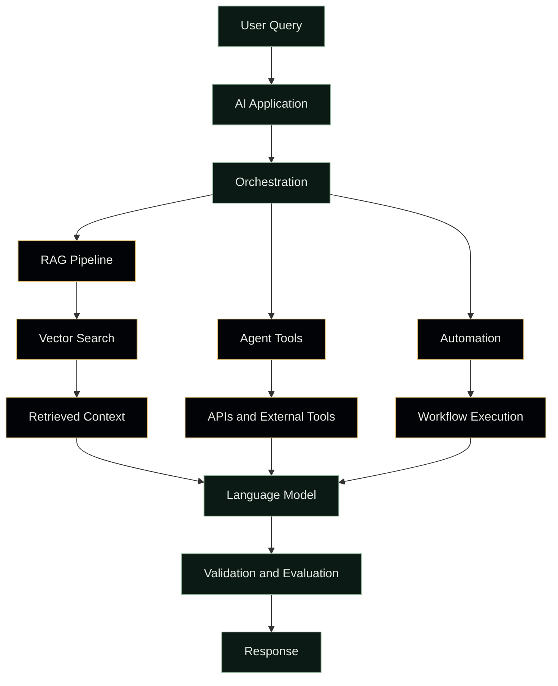

# 👋 Hi, I'm Manikanta Banavathu

<div align="center">


<a href="https://github.com/Manikanta-23-ai">
  
</a>
<a href="https://www.linkedin.com/in/mani-manikanta-796907385/">
  
</a>
<a href="https://leetcode.com/u/Manikanta109876/">
  
</a>
<a href="https://www.codewars.com/users/Manikanta-23-AI">
  
</a>

</div>

---

## 🧠 About Me

I'm **Manikanta Banavathu**, a Computer Science student interested in Generative AI, machine learning, deep learning, intelligent agents, and software engineering.

I'm interested in turning AI concepts into functional systems, from LLM applications and RAG pipelines to agentic workflows and cloud deployments.

<div align="center">

`LEARN` → `UNDERSTAND` → `BUILD` → `EXPERIMENT` → `DEPLOY` → `OPTIMIZE`

</div>

> Turning ideas into intelligent systems — one project at a time.

### 🔭 Current Focus

- 🤖 Generative AI and LLM applications
- 🧠 Deep learning and model evaluation
- 🔗 RAG and vector search
- 🕸️ AI agents and workflow orchestration
- 🧩 LangChain and LangGraph
- ⚙️ Automation and n8n
- ☁️ AWS cloud fundamentals
- 🐳 Docker and deployment

---

## 🧊 My AI Engineering Stack

<div align="center">

### 🤖 Programming


### 🧠 Machine Learning and Deep Learning


### 🧠 Generative AI and LLMs


### 🔗 Agents and Orchestration


### 🔎 RAG and Vector Search


### ☁️ Cloud and DevOps


### ⚡ Backend and Databases


</div>

<sub>Technology badges indicate tools used or being explored; they do not imply expert-level proficiency in every tool.</sub>

---

## 🧬 What I Build

```python
manikanta_engineering = {
    "Generative AI": [
        "LLM applications",
        "Prompt engineering",
        "AI assistants",
        "Structured outputs",
    ],
    "AI Agents": [
        "Tool-using agents",
        "Workflow orchestration",
        "API integrations",
        "Multi-step automation",
    ],
    "RAG Systems": [
        "Document question answering",
        "Semantic search",
        "Vector retrieval",
        "Knowledge assistants",
    ],
    "Machine Learning": [
        "Classification and regression",
        "Data preprocessing",
        "Model evaluation",
        "Deep learning experiments",
    ],
    "Software Engineering": [
        "Python development",
        "REST APIs",
        "Database integration",
        "Testing and documentation",
    ],
}
```

---

## 🚀 Featured Projects

<table>
<tr>
<td width="50%" valign="top">

### 🧠 Generative AI and LLMs

Experiments with question answering using language models and retrieval-augmented generation over a knowledge base.

**Technologies:** Python · LLMs · RAG

<a href="https://github.com/Manikanta-23-ai/LARGE-LANGUAGE-MODELS-PROJECTS-USING-GENERATIVE-AI">View repository →</a>

</td>
<td width="50%" valign="top">

### 📊 Machine Learning

Projects involving Iris classification, email spam detection, house-price prediction, and data analysis.

**Technologies:** Python · scikit-learn · Pandas

<a href="https://github.com/Manikanta-23-ai/MACHINE-LEARNING-PROJECTS-IN-ANALASIS-DATA-INSIGHTS">View repository →</a>

</td>
</tr>
<tr>
<td width="50%" valign="top">

### 🧩 Data Structures and Algorithms

Java solutions to common programming and interview-style problems.

**Technologies:** Java · DSA · Algorithms

<a href="https://github.com/Manikanta-23-ai/DATA-STRUCTURES-AND-ALGORITHMS..-">View repository →</a>

</td>
<td width="50%" valign="top">

### 🐍 Python Projects

Python programming exercises and practical projects covering fundamentals, automation, and data handling.

**Technologies:** Python · Programming

<a href="https://github.com/Manikanta-23-ai/PYTHON-PROJECTS-">View repository →</a>

</td>
</tr>
<tr>
<td width="50%" valign="top">

### 🕷️ Web Scraping

Python-based experiments in extracting and processing information from web pages.

**Technologies:** Python · BeautifulSoup · Selenium

<a href="https://github.com/Manikanta-23-ai/WEB-SCRAPING-PROJECTS-USING-PYTHON">View repository →</a>

</td>
<td width="50%" valign="top">

### 🌐 More Projects

Explore my other repositories, experiments, and ongoing development.

<a href="https://github.com/Manikanta-23-ai?tab=repositories">Explore all repositories →</a>

</td>
</tr>
</table>

---

## 🏗️ AI Engineering Architecture



*This is a conceptual architecture illustrating the systems I study, not a claim that every component is deployed in one production application.*

---

## ☁️ Cloud Engineering Roadmap

```text
AWS Fundamentals
       ↓
IAM and Networking
       ↓
EC2 and S3
       ↓
Databases and Serverless
       ↓
API Gateway and Messaging
       ↓
Docker and Containers
       ↓
CI/CD
       ↓
Monitoring and Security
       ↓
Production Architecture
```

## 🧠 Deep Learning Roadmap

```text
Python and NumPy
       ↓
Mathematics and Statistics
       ↓
Machine Learning
       ↓
Neural Networks
       ↓
Backpropagation and Optimization
       ↓
PyTorch
       ↓
CNNs and NLP
       ↓
Attention and Transformers
       ↓
Generative AI and LLMs
       ↓
RAG and AI Agents
       ↓
Evaluation and Deployment
```

---

## 🧪 Engineering Workflow

<div align="center">

`💡 IDEA` → `📋 REQUIREMENTS` → `🏗️ DESIGN` → `⚙️ IMPLEMENT`

`🧪 TEST` → `📊 EVALUATE` → `🚀 DEPLOY` → `📈 IMPROVE`

</div>

My target for each project:

- Define the problem and scope.
- Establish a simple baseline.
- Implement the solution incrementally.
- Test expected behaviour and failure cases.
- Record results and limitations.
- Document installation and execution.
- Improve based on evidence.

---

## 📚 Current Learning

| Area | Focus |
|---|---|
| 🧠 Deep Learning | Neural networks and Transformers |
| 🤖 Generative AI | LLM applications |
| 🔗 Agentic AI | Tool use and workflow orchestration |
| 🔎 RAG | Retrieval and vector search |
| ☁️ AWS | Cloud fundamentals and deployment |
| 🐳 DevOps | Docker and CI/CD |
| ⚙️ Automation | n8n and API workflows |
| 🎯 MLOps | Evaluation, deployment, and monitoring |

---

## 🏆 Experience and Development

| Program | Area |
|---|---|
| CODSOFT | Python development |
| JPMorgan Chase Forage | Software engineering job simulation |
| Self-driven projects | AI, machine learning, and software development |

---

## 📈 GitHub Analytics

<div align="center">


<br/><br/>


<br/><br/>


</div>

<sub>Analytics depend on external services and may occasionally be unavailable.</sub>

---

## 🐍 Contribution Snake

<div align="center">


</div>

<sub>Requires a GitHub Actions workflow that generates the SVG and publishes it to the output branch.</sub>

## 📊 My Engineering Principles

### 01 — Build First
Don't only consume tutorials. Build working implementations.

### 02 — Understand the Fundamentals
Frameworks change; core concepts remain useful.

### 03 — Experiment
Test ideas, measure results, and learn from failures.

### 04 — Automate
Automate repetitive work when it makes the process more reliable.

### 05 — Deploy
Learn what changes when a project runs outside a notebook.

### 06 — Document
Make projects understandable and reproducible for other developers.

---

## 🌐 Connect With Me

<div align="center">

<a href="https://github.com/Manikanta-23-ai">
  
</a>
<a href="https://www.linkedin.com/in/mani-manikanta-796907385/">
  
</a>
<a href="https://leetcode.com/u/Manikanta109876/">
  
</a>
<a href="https://www.codewars.com/users/Manikanta-23-AI">
  
</a>
<a href="mailto:banavathumanikanta23@gmail.com">
  
</a>

<br/><br/>

**🚀 Learn. Build. Deploy. Repeat.**


<sub>Thanks for visiting my profile! ⭐</sub>

</div>
